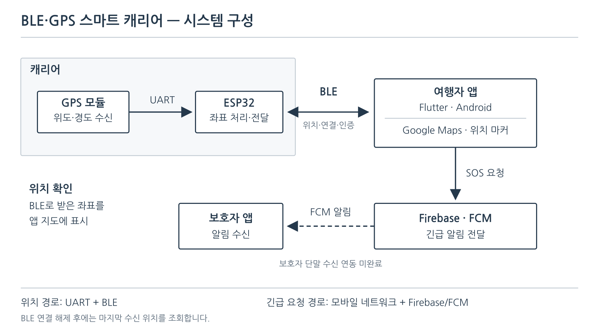
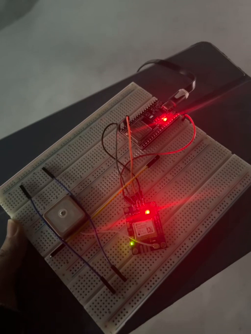
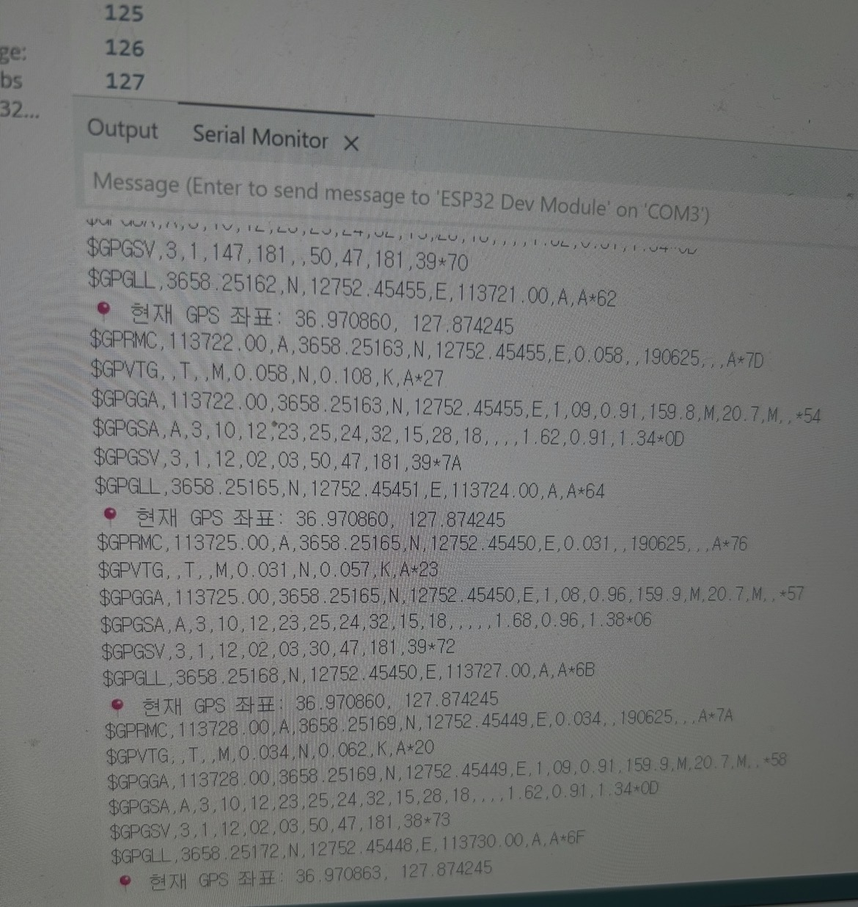
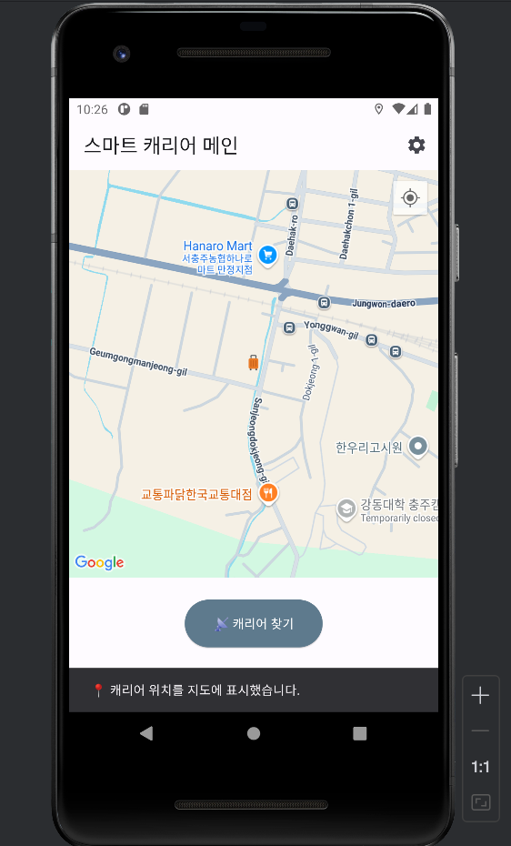
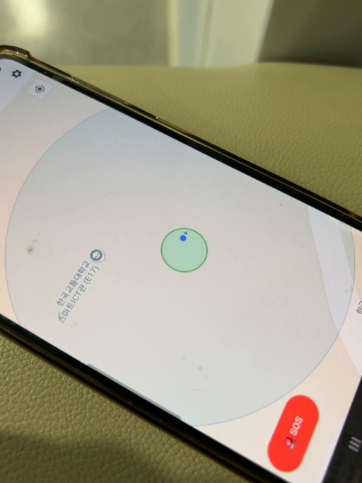
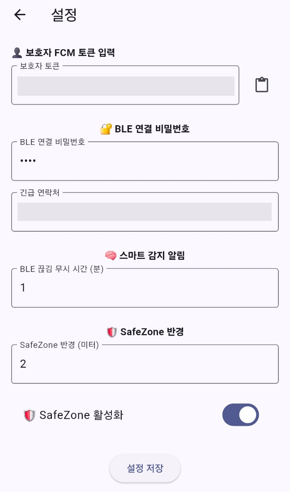

# BLE·GPS 스마트 캐리어

GPS–ESP32–BLE의 위치 데이터를 Flutter 지도와 연결하고, 캐리어 찾기·설정·SOS 요청과 팀원 기능을 통합했습니다.

## 개요

| 항목 | 내용 |
|---|---|
| 기간 | 2025.03–2025.06 · 4학년 1학기 캡스톤 |
| 형태 | 3인 팀 프로젝트 |
| 기술 | ESP32 · GY-GPS3V-NEO · UART · BLE · Arduino C++ · Flutter/Dart · Google Maps · Firebase/FCM |


## 담당 역할

| 담당 | 수행 내용 |
|---|---|
| **이승열 — 통신·앱 개발** | GPS–ESP32 연동, BLE 검색·연결·비밀번호 인증, 지도 마커와 캐리어 찾기 |
| **이승열 — 긴급 요청 기능** | SOS 버튼, 보호자·긴급 연락처 설정, 연결 상태와 요청 결과 표시 |
| **이승열 — 시스템 통합** | 앱 기본 구조 개발, 팀원 기능 코드 통합, 위치·연결 상태 디버깅, Firebase 배포 |
| 팀원 2 — 앱 안전 기능 | 스마트 알림·Safe Zone 개발 |
| 팀원 3 — 하드웨어 | 기울기 기반 모터 이동 보조와 소형 캐리어 형태 시제품 구현 |


## 설계·구현

### 시스템 설계



[구성도 편집 원본](assets/system-architecture.drawio)

GPS 모듈과 ESP32는 UART로 연결하고, ESP32와 스마트폰은 BLE로 통신합니다. Flutter 앱은 수신한 좌표를 Google Maps 마커에 반영합니다. SOS는 여행자 앱에서 Firebase/FCM을 거쳐 보호자 단말에 알림을 전달하는 구조로 설계했습니다.

BLE 연결 해제는 분실 가능성을 판단하는 조건으로 사용하며, 사용자가 직접 누르는 SOS와 구분합니다. 연결을 잃은 뒤에는 마지막으로 수신한 위치를 조회합니다. BLE 범위 밖에서 캐리어의 최신 위치를 계속 추적하는 구조는 아닙니다.

### 주요 기능

| 기능 | 내용 |
|---|---|
| GPS 위치 표시·캐리어 찾기 | 캐리어 좌표를 지도 마커로 표시하고 위치 조회 결과 안내 |
| BLE 검색·연결 | 주변 BLE 기기 검색, ESP32 연결 및 앱 수준 비밀번호 인증 |
| 상태 표시 | 연결 상태, 위치 조회 결과, SOS 요청 결과를 화면에 반영 |
| 스마트 알림 | 예기치 않은 연결 해제 후 유예 시간과 재연결 여부에 따라 분실 경고 |
| Safe Zone | 기준 좌표·반경을 설정하고 캐리어 위치의 영역 이탈 여부 판단 |
| SOS·보호자 설정 | 긴급 요청 버튼, 보호자 FCM 토큰과 긴급 연락처 설정 |

비밀번호 입력은 앱 수준의 접근 인증이며 BLE 페어링·전송 구간 암호화와는 별개입니다.


## 검증 결과

### 통합·디버깅

#### GPS 좌표는 수신되지만 지도 마커·캐리어 찾기에 반영되지 않음

- **문제:** 캐리어 마커가 나타나지 않거나, 캐리어 찾기가 실제 위치 대신 화면 초기화용 기본 좌표로 이동했습니다.
- **점검:** GPS 수신 → BLE 데이터 전달 → 앱 위치 저장 → 유효 좌표 판단 → 지도 마커 갱신을 나누어 확인했습니다. 특히 기본 좌표가 실제 수신 좌표 대신 참조되는지, 위치 조회 버튼과 마커가 같은 위치 상태를 사용하는지 점검했습니다.
- **결과:** ESP32 시리얼에서 NMEA 문장과 파싱 좌표 출력을 확인했습니다. **캐리어 마커 표시와 수신 위치 기반 캐리어 찾기의 정상 동작을 확인했습니다.**

#### BLE 연결 상태가 화면에 반영되지 않음

- **문제:** 캐리어와 멀어져도 앱의 연결 상태가 갱신되지 않아 SOS 버튼이 캐리어 찾기로 전환되지 않았습니다.
- **점검:** BLE 연결 이벤트 → 앱 연결 상태 → 버튼 전환 경로를 확인하고, 팀원의 스마트 알림·Safe Zone 기능을 통합했습니다. 수동 해제와 예기치 않은 해제, 유예 시간 내 재연결을 구분해 점검했습니다.
- **결과:** 팀원의 스마트 알림·Safe Zone을 통합하고, **BLE 연결 해제 상태 반영과 SOS → 캐리어 찾기 버튼 전환 오류를 해결했습니다.**

#### SOS 결과 메시지는 표시되지만 보호자 알림이 도착하지 않음

- **문제:** 여행자 앱에 전송 결과 메시지가 표시돼도 보호자 단말로 알림이 전달되지 않았습니다.
- **점검:** 앱의 SOS 요청, Firebase 전송 처리·보호자 FCM 토큰, 보호자 단말 수신을 단계별로 나누어 확인했습니다. 결과 메시지 표시와 실제 알림 수신을 별도로 판단했습니다.
- **결과:** SOS 버튼·보호자 설정·요청 결과 안내와 Firebase 배포를 담당했습니다. **보호자 알림 수신 연동은 미완료입니다.** 보호자 FCM 토큰 문제를 의심했으나, 최종 원인은 확정하지 못했습니다.

### 프로젝트 결과

| 영역 | 결과 |
|---|---|
| GPS 수신 | ESP32 시리얼에서 NMEA와 파싱 좌표 출력 확인 |
| 모바일 앱 | BLE 검색·연결·인증, 캐리어 찾기·지도 UI, SOS·설정 기능 개발 |
| 기능 통합 | 스마트 알림·Safe Zone 코드 통합, 지도 마커·위치 조회와 BLE 연결 해제·버튼 전환 오류 해결 |
| 보호자 알림 | Firebase 배포 및 SOS 요청 기능 개발, 보호자 단말 알림 수신 미완료 |
| 이동 보조 | 팀원 담당 기울기 기반 모터 이동 보조를 소형 캐리어 형태의 시제품에서 구현 · 실물 크기 캐리어는 미제작 |

### 동작 자료

| ESP32·GPS 실물 구성 | 실제 GPS 시리얼 출력 |
|---|---|
|  |  |

시리얼 모니터에서 NMEA 문장과 위도·경도 파싱 결과를 확인했습니다.

| 캐리어 위치 화면 | 실제 단말 지도 화면 |
|---|---|
|  |  |

- [BLE 기기 검색 화면](assets/app-ble-scan.jpeg)
- [ESP32·GPS 실물 영상](assets/hardware-demo.mp4)

#### 앱 설정 화면

<p align="center">
  
</p>

- **본인 담당:** 보호자 FCM 토큰 입력, BLE 연결 비밀번호, 긴급 연락처 설정
- **팀원 담당:** 스마트 감지 알림 유예 시간, Safe Zone 반경·활성화 설정

보호자 설정·SOS 요청 기능을 개발했으며, 보호자 단말의 알림 수신 연동은 미완료입니다.


## 실행 방법

<a id="소스와-실행"></a>

### 소스와 실행 절차

| 경로 | 내용 |
|---|---|
| [firmware/smart_carrier](firmware/smart_carrier) | ESP32 GPS 수신·BLE 서비스·위치 패킷 |
| [flutter_app](flutter_app) | 위치·BLE·설정·알림 UI와 서비스, Dart 테스트 |
| [firebase](firebase) | Firestore 규칙과 FCM 전송 함수 |
| [docs/PROTOCOL.md](docs/PROTOCOL.md) | 저장소 소스의 위치 패킷·GATT 명세 |
| [docs/HARDWARE.md](docs/HARDWARE.md) | 소스 기본 핀 설정과 하드웨어 실행 절차 |
| [docs/ANDROID_SETUP.md](docs/ANDROID_SETUP.md) | Flutter·Android·Firebase 설정 |
| [docs/TEST_PLAN.md](docs/TEST_PLAN.md) | 소스 검사·가상 시연·실기기 검증 절차 |
| [VERIFICATION_REPORT.md](VERIFICATION_REPORT.md) | 2026-10-09 소스 검사 결과 |

#### PC 소스 검사

```bash
python -m pip install -r requirements-test.txt
bash scripts/verify_offline.sh
```

#### Flutter 가상 시연

```powershell
cd flutter_app
flutter create --platforms=android --project-name smart_carrier_app .
flutter pub get
flutter run --dart-define=SMART_CARRIER_DEMO=true
```

가상 시연은 실제 BLE·GPS·Firebase를 사용하지 않습니다. Firebase 소스의 UID 연결·승인 구조는 [FIREBASE.md](docs/FIREBASE.md), 검사 결과와 실행 범위는 [소스 검증 결과](VERIFICATION_REPORT.md)에 정리했습니다.


---

[웹 포트폴리오](https://seungyeol-rtl-portfolio.azuretide33.chatgpt.site) · [GitHub 프로필](https://github.com/lsy49055089)

[논문](https://github.com/lsy49055089/Parallel-Decision-Tree-Hardware) · [RTL / FPGA Design](https://github.com/lsy49055089/RTL-Design-Projects) · [Design Verification](https://github.com/lsy49055089/RTL-Verification-Projects) · [Embedded Systems](https://github.com/lsy49055089/Embedded-Systems-Projects) · [AI / CV](https://github.com/lsy49055089/AI-Projects)
